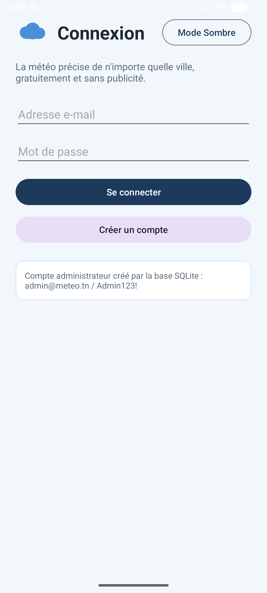
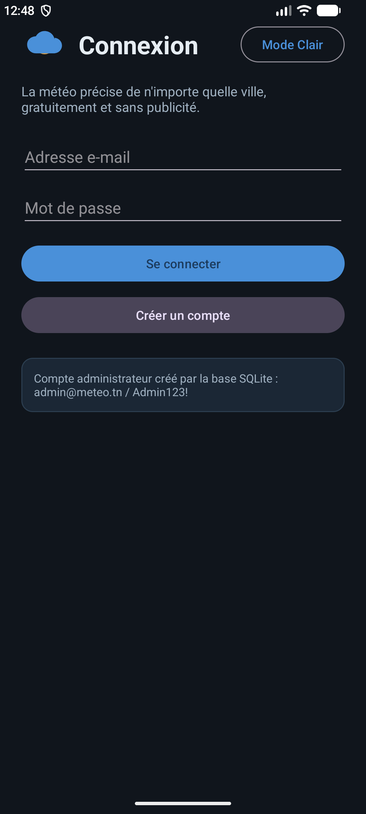
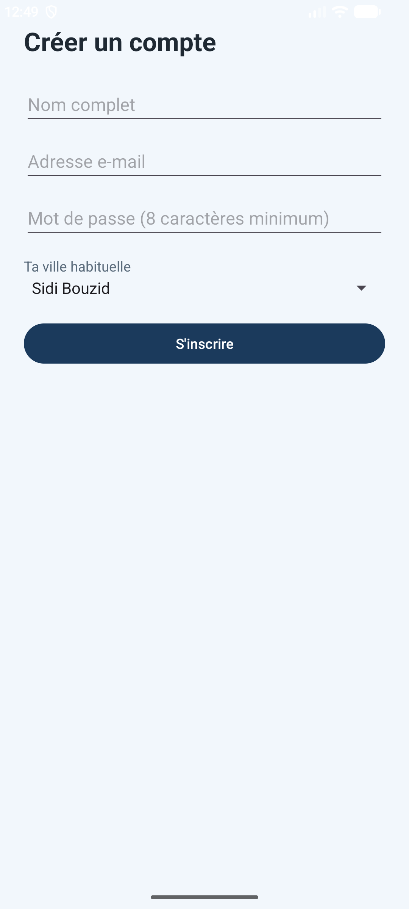
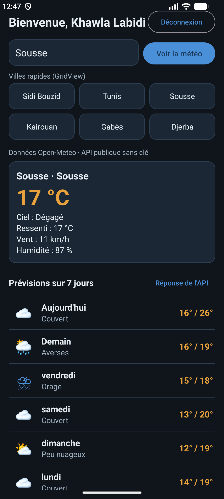
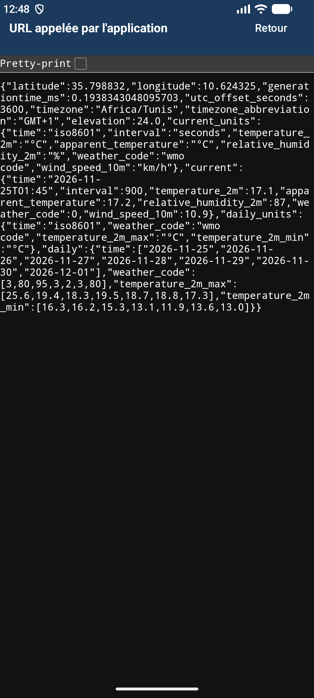
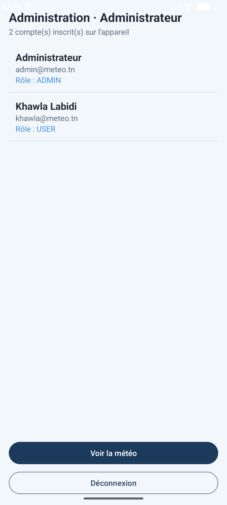

# Météo Poche

Application Android native (**Java + XML**, Android Studio) qui répond à un problème réel : **savoir en deux secondes quel temps il fait réellement dans une ville tunisienne** — pour sortir, voyager, travailler aux champs ou annoncer un examen — sans écran de publicité, sans compte distant et sans clé API à payer.

Les applications météo classiques imposent un compte cloud, la géolocalisation permanente et des dizaines de mégaoctets de publicité. **Météo Poche** fait l'inverse : un compte **local à l'appareil** (SQLite), une barre de ville, sept jours de prévisions, un mode sombre.

---

## 1. Parcours de l'application

| Écran | Activity | Rôle |
| --- | --- | --- |
| Connexion | `MainActivity` | E-mail + mot de passe vérifiés contre SQLite, bouton **Mode Sombre / Mode Clair** |
| Inscription | `RegisterActivity` | Crée un compte `USER`, validation des champs, ville préférée |
| Espace utilisateur | `UserDashboardActivity` | Météo du jour + **ListView** des 7 jours + **GridView** de villes rapides + **WebView** de l'URL appelée |
| Espace administrateur | `AdminDashboardActivity` | **ListView** de tous les comptes inscrits, garde-fou sur le rôle |

Compte administrateur créé par la base à la première exécution : `admin@meteo.tn` / `Admin123!`.

---

## 1.1 L'application en fonctionnement

Captures réelles, émulateur Android (API 37), testées une par une :

| Connexion (clair) | Connexion (sombre) | Inscription |
| --- | --- | --- |
|  |  |  |

| Espace utilisateur : API en direct | Réponse JSON dans la WebView | Espace administrateur |
| --- | --- | --- |
|  |  |  |

---

## 2. Stack technique

- **Langage** : Java 11 (aucun Kotlin)
- **Interface** : XML uniquement, aucune vue construite à la main en Java
- **IDE** : Android Studio — AGP 9.4.1, Gradle 9.6.0
- **SDK** : compile/target 37, `minSdk` 24 (Android 7.0+)
- **Base de données** : `SQLiteOpenHelper` (SDK Android)
- **Réseau** : `HttpURLConnection` + `org.json`
- **Dépendances tierces** : **aucune** pour le métier. Pas de Retrofit, pas de Glide, pas de Room : tout repose sur le SDK, donc le build fonctionne hors ligne et l'APK reste léger.

---

## 3. Concepts des cours intégrés

Le projet applique volontairement les deux cours du module, sans rien ajouter de plus difficile.

| Concept du cours | Où il est utilisé dans Météo Poche |
| --- | --- |
| Thème dynamique Jour / Nuit | `res/values/colors.xml` + `res/values-night/colors.xml` |
| `SharedPreferences` + `AppCompatDelegate.setDefaultNightMode()` | `MainActivity` (lu **avant** `setContentView` pour éviter le flash) |
| `SQLiteOpenHelper`, table avec `CHECK` et `COLLATE NOCASE` | `UserDbHelper` |
| Sel `SecureRandom` + PBKDF2-HMAC-SHA256 + comparaison en temps constant | `UserDbHelper.createSalt / hashPassword / constantTimeEquals` |
| Rôles et redirection après connexion | `Role`, `UserProfile`, `MainActivity.login()` |
| `ListView` + `BaseAdapter` + `getView()` + patron **ViewHolder** | `PrevisionAdapter` + `item_prevision.xml` |
| `BaseAdapter` pour une liste à plusieurs champs | `UserAdapter` + `row_user.xml` |
| `ArrayAdapter` + `GridView` (`numColumns="auto_fit"`, `columnWidth`) | `UserDashboardActivity` + `item_ville.xml` |
| `OnItemClickListener` + `getItemAtPosition()` | Clic sur une ville de la grille ou sur un compte admin |
| `WebView` + `loadUrl()` + permission `INTERNET` | `WebViewActivity` |
| `Toast`, `EditText.setError()`, `Patterns.EMAIL_ADDRESS` | `MainActivity`, `RegisterActivity` |
| Déclaration des activities dans `AndroidManifest.xml` | `RegisterActivity`, `UserDashboardActivity`, `AdminDashboardActivity`, `WebViewActivity` |

---

## 4. Intégration et consommation d'une API externe

Le cœur technique : **deux points d'entrée de l'API publique [Open-Meteo](https://open-meteo.com)**, gratuite, **sans clé API** et sans inscription.

### 4.1 Les deux appels enchaînés

| Étape | Endpoint | Paramètres | Ce qu'on en tire |
| --- | --- | --- | --- |
| 1. Géocodage | `https://geocoding-api.open-meteo.com/v1/search` | `name`, `count=1`, `language=fr`, `format=json` | `latitude`, `longitude`, `name`, `admin1` |
| 2. Prévisions | `https://api.open-meteo.com/v1/forecast` | `latitude`, `longitude`, `current=…`, `daily=weather_code,temperature_2m_max,temperature_2m_min`, `timezone=auto` | temps actuel + 7 jours |

L'API météo n'accepte **que** des coordonnées : l'application convertit d'abord le texte saisi en position, puis interroge la météo. `timezone=auto` aligne les journées sur le fuseau local de la ville (`Africa/Tunis`), pas sur UTC.

### 4.2 Le code de consommation

```java
public static Metee charger(String ville) throws IOException {
    String urlGeocodage = "https://geocoding-api.open-meteo.com/v1/search?name="
            + URLEncoder.encode(ville, "UTF-8") + "&count=1&language=fr&format=json";

    JSONArray resultats = new JSONObject(lireJson(urlGeocodage)).optJSONArray("results");
    if (resultats == null || resultats.length() == 0) throw new VilleIntrouvable();
    JSONObject lieu = resultats.optJSONObject(0);

    String urlPrevisions = "https://api.open-meteo.com/v1/forecast?latitude="
            + lieu.optString("latitude") + "&longitude=" + lieu.optString("longitude")
            + "&current=temperature_2m,apparent_temperature,relative_humidity_2m,weather_code,wind_speed_10m"
            + "&daily=weather_code,temperature_2m_max,temperature_2m_min&timezone=auto";

    JSONObject reponse = new JSONObject(lireJson(urlPrevisions));
    JSONObject courant = reponse.getJSONObject("current");
    JSONObject quotidien = reponse.getJSONObject("daily");
    // ... construction du DTO Metee et de ses 7 objets Prevision
}
```

La couche HTTP est isolée dans une seule méthode, réutilisable contre n'importe quelle API JSON :

```java
public static String lireJson(String url) throws IOException {
    HttpURLConnection connexion = (HttpURLConnection) new URL(url).openConnection();
    connexion.setConnectTimeout(8000);
    connexion.setReadTimeout(8000);
    connexion.setRequestProperty("Accept", "application/json");
    try {
        if (connexion.getResponseCode() != HttpURLConnection.HTTP_OK)
            throw new IOException("HTTP " + connexion.getResponseCode());
        // lecture ligne à ligne du flux ...
    } finally {
        connexion.disconnect();
    }
}
```

### 4.3 Points techniques à savoir expliquer

- **Permission** : `<uses-permission android:name="android.permission.INTERNET" />` dans le manifeste. Elle ne demande aucune autorisation à l'exécution.
- **Jamais de réseau sur le thread UI** : sans `new Thread(...)` puis `runOnUiThread(...)`, Android lève une `NetworkOnMainThreadException`. C'est le rôle de `MeteoService.rechercher(ville, listener)`.
- **Encodage de l'URL** : `URLEncoder.encode(ville, "UTF-8")` rend « Sidi Bou Zid » et les accents valides dans la requête.
- **Codes WMO** : `weather_code` est un code normalisé par l'Organisation météorologique mondiale (0 = dégagé, 3 = couvert, 61 = pluie, 95 = orage). `MeteoService.decrire()` le traduit en français et `symbole()` lui associe un glyphe affiché dans la `ListView`.
- **DTO séparé** : `Metee` et `Prevision` ne contiennent que des textes déjà formatés, produits sur le thread de fond ; l'interface n'affiche jamais de JSON brut.
- **Preuve dans l'application** : le bouton « Réponse de l'API » ouvre une `WebView` sur l'URL exacte appelée, ce qui montre la réponse JSON réelle sur place.

---

## 5. Authentification locale : ce qui est stocké et pourquoi

`UserDbHelper` hérite de `SQLiteOpenHelper` et crée la table :

```sql
CREATE TABLE users (
  id INTEGER PRIMARY KEY AUTOINCREMENT,
  full_name TEXT NOT NULL,
  email TEXT NOT NULL COLLATE NOCASE UNIQUE,
  password_hash TEXT NOT NULL,
  salt TEXT NOT NULL,
  ville_preferee TEXT,
  role TEXT NOT NULL CHECK (role IN ('ADMIN', 'USER'))
)
```

Aucun mot de passe n'est stocké en clair :

- **sel** : 16 octets aléatoires par utilisateur via `SecureRandom`, pour que deux mots de passe identiques donnent deux hachés différents ;
- **hachage** : `PBKDF2WithHmacSHA256`, 120 000 itérations, 256 bits — on ralentit volontairement une attaque par force brute ;
- **comparaison** : `constantTimeEquals()` compare octet par octet avec un XOR cumulé, pour que la durée de la comparaison ne révèle pas la position du premier caractère différent ;
- **e-mail** : `COLLATE NOCASE UNIQUE` rend `Admin@Meteo.tn` et `admin@meteo.tn` identiques et empêche les doublons ;
- **rôle** : la contrainte `CHECK` bloque tout rôle inconnu au niveau de la base, et `AdminDashboardActivity` re-vérifie le rôle avant d'afficher les comptes.

Les données ne quittent jamais le téléphone : il n'y a aucun serveur applicatif.

---

## 6. Arborescence

```
MonMeteo/
├── app/src/main/
│   ├── AndroidManifest.xml                 // permission INTERNET + 4 activities
│   ├── java/com/example/monmeteo/
│   │   ├── MainActivity.java               // thème + connexion + redirection par rôle
│   │   ├── RegisterActivity.java           // inscription et validation
│   │   ├── UserDashboardActivity.java      // météo, ListView, GridView, WebView
│   │   ├── AdminDashboardActivity.java     // liste des comptes (ListView)
│   │   ├── WebViewActivity.java            // loadUrl() sur l'API
│   │   ├── UserDbHelper.java               // SQLite + sel + PBKDF2
│   │   ├── PrevisionAdapter.java           // BaseAdapter + ViewHolder
│   │   ├── UserAdapter.java                // BaseAdapter, 3 champs par ligne
│   │   ├── MeteoService.java               // HttpURLConnection + JSON + WMO
│   │   ├── Metee.java / Prevision.java     // modèles
│   │   ├── Role.java / UserProfile.java    // authentification
│   └── res/
│       ├── layout/  activity_main · activity_register · activity_user_dashboard
│       │            activity_admin_dashboard · activity_web_view
│       │            item_prevision · item_ville · row_user
│       ├── drawable/ fond_carte.xml · soleil_pluie.xml
│       ├── values/       colors · dimens · strings · arrays · themes
│       └── values-night/ colors · themes
├── livrable/MeteoPoche-v2.0-debug.apk      // APK livré, versionné
└── README.md
```

---

## 7. Générer et livrer l'APK

**Depuis Android Studio** : `Build → Generate Bundles(s)/APK(s) → Build APK(s)`, puis `Build → Analyze APK…` pour vérifier le contenu.

**En ligne de commande**, à la racine du projet :

```
./gradlew assembleDebug
```

Sortie naturelle de Gradle :

```
app/build/outputs/apk/debug/app-debug.apk
```

L'APK est ensuite copié, versionné et livré ici :

```
livrable/MeteoPoche-v2.0-debug.apk
```

`app/build/` reste ignoré par Git (`app-debug.apk` est régénéré à chaque build) ; seul le fichier livré est commité, pour que la livraison — code source + binaire installable — tienne dans un seul dépôt.

### Installer l'APK sur un téléphone

1. Copier `MeteoPoche-v2.0-debug.apk` sur le téléphone (câble USB, WhatsApp, Drive…).
2. Ouvrir le fichier avec le gestionnaire de fichiers → autoriser **« Installer des applications inconnues »** pour cette source.
3. Lancer **Météo Poche**, s'inscrire, ou se connecter avec `admin@meteo.tn` / `Admin123!`.

Alternative via ADB, téléphone en débogage USB :

```
adb install -r livrable/MeteoPoche-v2.0-debug.apk
```

L'APK est signé avec la clé de debug Android Studio : suffisant pour un examen, insuffisant pour le Play Store (nécessiterait `assembleRelease` + une clé de signature personnelle).

---

## 8. Publication GitHub

Dépôt : `https://github.com/labidikhawla/MonMeteo`

```
git init -b master
git add .
git commit -m "…"          // un commit par étape du développement
git remote add origin https://github.com/labidikhawla/MonMeteo.git
git push -u origin master
```

L'historique est volontairement découpé par étape (thème, base de données, activités, adaptateurs, API, livraison APK) plutôt qu'en un seul dépôt final.

---

## 9. Limites assumées

- Aucune mise en cache : chaque recherche retape deux requêtes réseau.
- Pas de géolocalisation automatique : la ville est saisie ou choisie dans la grille.
- Les données météo restent dépendantes d'Open-Meteo : hors connexion, l'écran affiche un message d'erreur au lieu d'un ancien résultat.
- L'inscription est locale : réinstaller l'application repart d'une base vide (aucun compte n'existe avant la première exécution).

## 10. Évolutions possibles

1. Mettre en cache la dernière réponse JSON dans SQLite et l'afficher hors ligne.
2. Ajouter une `RecyclerView` en alternative à la `ListView`.
3. Proposer une deuxième vue des mêmes données : graphique des températures sur 7 jours.
4. Notifier chaque matin la météo de la ville préférée avec `WorkManager`.
